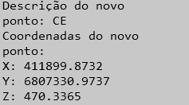
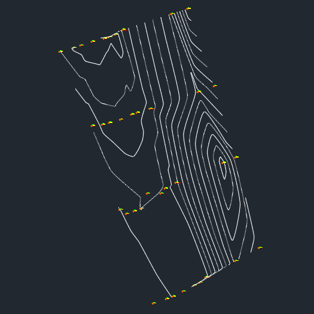

# Exemplos de uso do RAPCON

## Situação do exemplo

Em um levantamento topográfico, alguns pontos não são medidos com a estação total. Eles são medidos com trena e nível a partir de um ponto já levantado: por exemplo, o terreno natural (TN) e a cerca ao lado da faixa. Em campo, anota-se a **distância** e a **diferença de cota** em relação a esse ponto.

O RAPCON cria esses pontos COGO automaticamente, na direção indicada pelo usuário. Depois disso, basta reconstruir a superfície (*Rebuild*) para que ela passe a incluir os novos pontos.

O arquivo `exemplo_01.dwg` tem um trecho de levantamento com **4** pontos de partida já preparados. A descrição de cada um traz as medidas de campo que devem ser usadas.

## Requisitos

- AutoCAD Civil 3D (versão testada: **2027**)
- `src/RAPCON/RAPCON.lsp`
- `exemplos/exemplo_01.dwg`

## Passo a passo

### 1. Abrir o desenho e carregar a rotina
1. Abra `exemplo_01.dwg`.
2. Digite `APPLOAD`, selecione `src/RAPCON/RAPCON.lsp` e clique em **Load**.
3. A linha de comando mostra "R.A.P.C.O.N - Random Points Created Out of Nothing", que confirma o carregamento.

### 2. Ligar o OSNAP *Node*
Pressione `F3` ou use o menu *Object Snap* e ative **Node**. Com isso, ao clicar no ponto COGO, a rotina pega também a **cota (Z)** dele. Sem o Node, o Z fica igual a 0 e o resultado sai errado.

### 3. Executar o comando
Digite `RAPCON` e responda às perguntas:

| Pergunta | O que fazer |
|---|---|
| Selecione ponto de partida | Clique no centro do ponto COGO **56677** (descrição `10-4TN 8+1CE`) |
| Determine a direção | Clique em um ponto **perpendicular à faixa**, seguindo o alinhamento dos pontos vizinhos |
| Distância do ponto anterior | `10` |
| Diferença de cota (+/-) | `-4` |
| Descrição do novo ponto | `TN` |

O ponto **TN** é criado. Em seguida, o comando pede o próximo ponto:

| Pergunta | Valor |
|---|---|
| Distância do ponto anterior | `8` (medida **a partir do ponto TN**, o último criado) |
| Diferença de cota (+/-) | `1` (em relação ao TN) |
| Descrição do novo ponto | `CERCA` |

Pressione **Enter** sem digitar nada na distância para encerrar.

> Como ler a descrição do ponto de partida: `10-4TN 8+1CE` quer dizer "10 m e −4 m até o TN; depois 8 m e +1 m até a cerca".

### 4. Conferir o resultado
A linha de comando mostra X, Y e Z de cada ponto criado. Confira à mão com as fórmulas do [memorial de cálculo](../docs/memorial_calculo_rapcon.md):

| Ponto | X (m) | Y (m) | Z (m) |
|---|---|---|---|
| Ponto de partida (56677) | 411884,1074 | 6807322,2881 | 473,337 |
| TN | 411892,8662 | 6807327,1134 | 469,337 |
| CERCA | 411899,8732 | 6807330,9737 | 470,337 |

Conferência: a distância horizontal entre o ponto de partida e o TN é 10,000 m, e entre o TN e a cerca é 8,000 m. As cotas são 473,337 − 4 = 469,337 e 469,337 + 1 = 470,337.

### 5. Atualizar a superfície
No *Toolspace → Prospector*, clique com o botão direito na superfície **PROJ** e escolha **Rebuild**. A superfície passa a incluir os novos pontos.

**Antes:**

**Depois:**

### 6. Repetir para os outros pontos
Repita os passos 3 a 5 para os outros pontos de partida destacados no desenho:

| Ponto de partida | Descrição | Distância TN | ΔZ TN | Distância CERCA | ΔZ CERCA |
|---|---|---|---|---|---|
| 56677 | `10-4TN 8+1CE` | 10 | -4 | 8 | +1 |
| 55543 | `15-5TN 4+2CE` | 15 | -5 | 4 | +2 |
| 56676 | `15-3TN 5+1CE` | 15 | -3 | 5 | +1 |
| 55555 | `15-3TN 5+3CE` | 15 | -3 | 5 | +3 |

## Observações

- **Cada ponto da sequência é medido a partir do ponto criado antes dele**, e não a partir do primeiro ponto.
- A direção é definida uma única vez, no primeiro clique, e vale para todos os pontos da sequência.
- Se o comando não pedir descrição ou cota, ative **Prompt For Descriptions** e **Prompt For Elevations** em *Point Creation*.